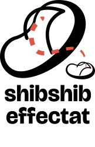

<p align="center">
  
</p>

<h1 align="center">ShibShib effectat</h1>

<p align="center">
  <b>Free, open-source motion graphics and visual effects — part of the ShibShib creative suite.</b><br>
  <b>موشن جرافيك وتأثيرات بصرية، مجاني ومفتوح المصدر — جزء من حزمة شبشب.</b>
</p>

<p align="center">
  <a href="https://shibshib.art/">shibshib.art</a>
</p>

<p align="center">
  
  
</p>

## Built on EffectCraft

ShibShib effectat is a fork of **[EffectCraft](https://github.com/storytold/effectcraft)**, the
open-source, clean-room motion graphics and visual effects compositor written in Rust by the
**[ArtCraft](https://getartcraft.com/)** team and the EffectCraft contributors. Almost everything
that makes this app work is their work. Thank you. If you like ShibShib effectat, please star and
support the upstream project as well.

What we add: the ShibShib identity, an Arabic interface laid out right to left (planned), and Arabic
features to come. Our changes are listed in [`shibshib/CHANGES.md`](shibshib/CHANGES.md).
Upstream's own README, with the full feature list and build instructions, is in
[`docs/UPSTREAM-README.md`](docs/UPSTREAM-README.md).

## The ShibShib suite

| App | What it's for | Based on |
|---|---|---|
| [ShibShib rsm](https://github.com/7mz410/ShibShib-rsm) | Vector illustration | VectorCraft |
| [ShibShib ttshat](https://github.com/7mz410/ShibShib-ttshat) | Photo library and raw development | LightCraft |
| [ShibShib tlween](https://github.com/7mz410/ShibShib-tlween) | Image editing | PhotoCraft |
| [ShibShib tsweer](https://github.com/7mz410/ShibShib-tsweer) | Video editing | FilmCraft |
| **ShibShib effectat** | Motion graphics and effects | EffectCraft |

More apps are on the way: see [shibshib.art](https://shibshib.art/).

## Building

```sh
cargo run --release -p effectcraft
# after merging upstream:
git fetch upstream && git merge upstream/main && python3 shibshib/rebrand.py
```

## Licence

Code: MIT OR Apache-2.0 (`LICENSE-MIT`, `LICENSE-APACHE`, `NOTICE`), like upstream. The ShibShib
name and logos in `docs/shibshib/` belong to the ShibShib project.
